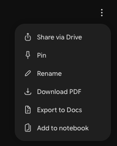
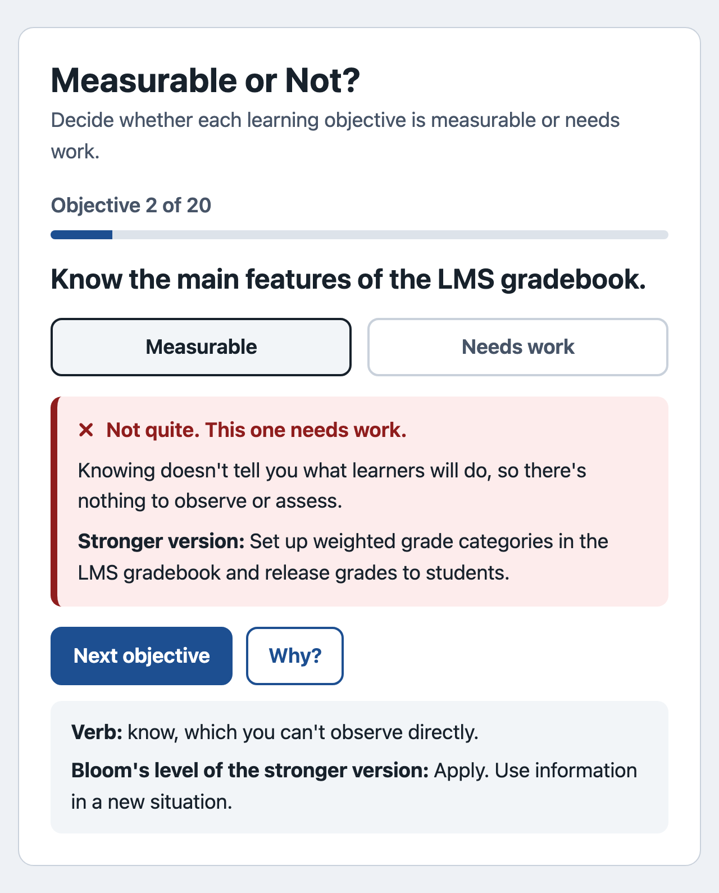
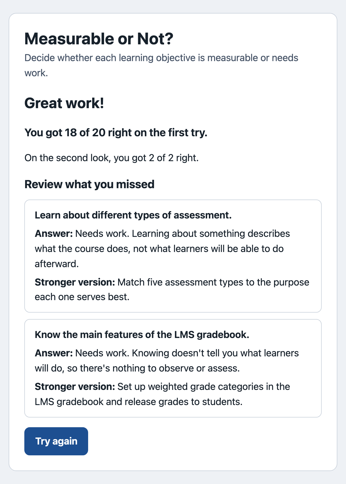

[ ·  ·  · ]{.small-muted}

::: {.session-link}
::: {.session-qr}
{fig-alt="QR code that opens this page, go.ncsu.edu/ai-idig"}
:::

::: {}
[Follow along on your own screen at]{.session-lead}
[](){.session-go}
:::
:::

::: {.callout-important}
## How to use this guide

This is the page we work from in the session. Every step is written out, so you can follow along, catch up if you
fall behind, and come back to it later.

- You need a laptop or desktop and your NC State login. There is nothing to install.
- A dark box holds a prompt or a file, with a **Copy** button. Replace the parts in [brackets] before you send it.
- An **Answer key** opens when you click it. Try the step first.
:::

# Welcome {#welcome .unnumbered}

Vibe coding means describing what you want in plain language and letting an AI tool write the code. Andrej Karpathy
named it in February 2025, when he described giving in to the vibes and forgetting "that the code even exists."
Simon Willison adds a useful limit. Once you have reviewed, tested and understood what the AI wrote, it isn't vibe
coding anymore. Vibe coding is fine for a quick prototype. Anything learners rely on gets reviewed and tested.

Today we build one small practice activity with Gemini Canvas, improve it and test it. Then we watch an AI agent turn
the same activity into something you could put in a course.

By the end of this session you will be able to:

- Describe a learning activity to Gemini Canvas so that it builds a working first version.
- Change the activity one step at a time, asking for a plan before each change.
- Test what the AI made, both whether it works and whether its content is right.
- Get the activity out of Canvas as a file you can use elsewhere.
- Say what an agentic coding tool adds, and how to get one at NC State.

## What you told us {#told .unnumbered}

Sixteen of you answered the survey before the session. Here is what shaped today.

| What you said | What we do with it |
| ------------------ | ------------------ |
| 15 of 16 use AI chat, mostly for brainstorming, research and writing. | We go past chat, to tools that build things (@sec-paths). |
| 3 of 16 use coding assistants, and 5 of 14 have used a tool that works through several steps toward a goal. | The agent demo is for you, and you can follow it on your own machine (@sec-agent). |
| All 15 of you who named a concern named accuracy. | Every part of the session includes a way to test what the AI made. |
| You asked for examples from peers, tools that work reliably, the whole process from prompt to hosting, and ways to use this with Articulate. | Volunteers show what they built, and @sec-host covers your LMS, Storyline and Rise. |

## About the activity {#about .unnumbered}

Everyone builds the same activity, "Measurable or Not?". It shows one learning objective at a time, asks whether it
is measurable or needs work, and explains the answer. Everyone in instructional design knows the task, it's small
enough to build in a few minutes, and it has answers you can check.

# Choose your path {#sec-paths}

There are three ways to build with AI, and each one goes further than the last. Start where you are.

| | Tier | What happens | Start at |
| ------ | ---- | ------------------ | ---- |
| New to AI tools | 0 · Chat | You ask, and you get text back. A five-minute warm-up. | @sec-chat |
| Everyone, in the session | 1 · Canvas | The AI builds a small app and runs it beside the chat. We build one together. | @sec-build |
| Already use a coding agent | 2 · Agentic | An agent works in real files, tests its own work, and packages it for your LMS. | @sec-agent |

The habits carry from tier to tier. Say who it's for and what it should do, look at the result, change one thing at
a time, and test it before anyone relies on it.

# Warm up with chat {#sec-chat}

[Tier 0 · For anyone new to AI tools. Try these while everyone else sets up.]{.question}

## Sign in {#sec-signin}

Open [gemini.google.com]() and sign in with your NC State account. Use that account for
university work. NC State's [approved AI list]() rejects the free public versions
of Gemini, ChatGPT and Copilot.

## Ask for an explanation {#sec-explain}

::: {.prompt}
```default
Explain the difference between a measurable and a non-measurable learning objective for someone new to course design. Give three examples of each, and say what makes the measurable ones measurable.
```
:::

## Improve one of your own {#sec-improve}

::: {.prompt}
```default
Rewrite this learning objective so it is measurable, and explain each change: [paste an objective]
```
:::

**Check:** read the rewrite. It should still say what you meant.

## Check before you rely on it {#sec-rely}

- Ask what it's unsure about. It will often tell you.
- Ask for sources, then open them. Some won't say what it claims.
- Compare the answer with what you already know about the topic.
- Have a person review anything learners or colleagues will rely on.

# Build a practice activity {#sec-build}

[Tier 1 · Gemini Canvas · Everyone, in the session]{.question}

Canvas is a tool in Gemini that writes a small app and runs it in a panel beside the chat. You describe the activity,
Canvas builds it, and you click through it right away.

## Open Canvas {#sec-open}

1. Join from a laptop or desktop. Two screens help, with Zoom on one and your browser on the other.
2. Open [gemini.google.com]() and sign in with your NC State account.
3. Choose **Canvas** from the tools under the chat box.

If Canvas won't open, follow along on the shared screen. Every prompt here works later too.

## Describe the activity {#sec-describe}

Send this prompt.

::: {.prompt}
```default
Act as an instructional designer who also writes clean, accessible web code.

Build an interactive practice activity called "Measurable or Not?" that helps people learn to spot measurable learning objectives.

The learners are faculty and staff who are new to writing learning objectives.

Keep the tone friendly and encouraging. Use a clean layout, large readable text, and high-contrast colors.

How it should work:
- Show one learning objective at a time with two buttons: "Measurable" and "Needs work".
- After each choice, say whether it was right and explain why in 1 or 2 sentences. For objectives that need work, suggest a stronger verb.
- Use 8 objectives, a mix of strong and weak.
- Show progress (for example, "3 of 8") and end with a score screen and a "Try again" button.
- Make everything work with a keyboard alone.
- Put everything in a single HTML file.
```
:::

**Check:** the activity appears in a panel beside the chat. Answer a few objectives.

The prompt has five parts, and each one is there for a reason. Their first letters spell PARTS.



| | Part | Why it's there |
| - | ---------- | ------------------ |
| [P]{.num} | Persona, who the AI should act as | It writes as an instructional designer would, so the feedback sounds like one. |
| [A]{.num} | Aim, what you want in one sentence | It knows what to build and what the activity is for. |
| [R]{.num} | Recipients, who it's for | It pitches the objectives and the feedback at the right level. |
| [T]{.num} | Theme, the tone, style and constraints | The look and the tone fit your learners without a second round. |
| [S]{.num} | Structure, how it should work | Each line is something you can check when you click through. |

## Ask for a plan before a change {#sec-plan}

Ask for ideas first, and don't let it change anything yet.

::: {.prompt}
```default
Before changing anything, suggest 3 ways to make the feedback more useful for learning. Number them and wait for me to choose.
```
:::

Then pick one.

::: {.prompt}
```default
Do number 2. Change nothing else.
```
:::

**Check:** only the feedback changed. If anything else moved, say so in the chat and ask it to put it back.

With one change at a time, you can see what each change did, and undo it if you don't like it.

## Test that it works {#sec-test}

::: {.prompt}
```default
Write a short test checklist, 6 steps or fewer, that I can click through to confirm this activity works, including using it with only a keyboard.
```
:::

Then click through the checklist yourself. Tab moves between buttons, and Enter or Space presses one.

## Check the content {#sec-content}

The AI wrote the objectives as well as the code. Ask it to review them.

::: {.prompt}
```default
Review your 8 objectives as an experienced instructional designer would. Which ones could reasonably be classified differently, and why?
```
:::

Then decide for yourself. A test can show that the activity works, but only you can say whether its answers are
right.

::: {.callout-note collapse="true" icon=false}
## Answer key

Your 8 objectives differ from everyone else's, so this key lists what to look for.

- **Vague verbs need work.** Understand, know, appreciate, learn about, be aware of, become familiar with, explore and
  "demonstrate an understanding of" name nothing you can observe, so an objective built on one needs work.
- **Observable verbs are measurable at every level of Bloom's taxonomy.** List and define (Remember), explain and
  summarize (Understand), apply and calculate (Apply), compare and differentiate (Analyze), evaluate and justify
  (Evaluate), design and create (Create).
- **Where people disagree.** "Evaluate the credibility of an online source" names a behavior you can observe, so it's
  measurable. A strict ABCD reading (audience, behavior, condition, degree) still asks for a condition and a standard
  of success. "Demonstrate" is measurable when a skill follows it, as in "demonstrate how to set up a gradebook," and
  vague when "an understanding of" follows it.
:::

## Make it yours {#sec-yours}

Pick one. Keep going in the same chat, so the AI changes the activity you already have.

### Option A: use your own objectives

::: {.prompt}
```default
Replace the objectives with these from my course. For each one, decide whether it is measurable, and write the feedback and a stronger version if it needs work. Keep everything else the same.

[paste 4 to 8 objectives]
```
:::

**Check:** go through its calls. Would you have classified each one the same way?

### Option B: same activity, new topic

::: {.prompt}
```default
Keep the same activity, but change it to help [audience] practice telling [category A] from [category B], for example formative or summative assessment. Use 8 examples and keep everything else the same.
```
:::

The two buttons work for any pair, such as primary or secondary sources, or objectives and activities.

For something different, start one of the [extra activities](#extras) in a new chat. Want to show what you made?
Raise your hand in Zoom and share your browser tab.

::: {.callout-warning}
## Gotcha: something breaks

Say what you did, what you expected and what happened instead, and ask for one fix.

::: {.prompt}
```default
When I [what you did], I expected [what should happen], but [what actually happened]. Fix only that, and tell me what was wrong.
```
:::
:::

## Keep a record {#sec-record}

A chat is easy to lose, and Canvas may build the same thing differently tomorrow. Before you leave the chat, ask for
a prompt that would rebuild your activity.

::: {.prompt}
```default
Write one prompt that would rebuild this activity from scratch, including every change we made.
```
:::

Save it with your course files. It's also a good first brief for an agent later (@sec-agent). To keep the chat too,
pin it or export it.

| Way | How |
| ---- | ---------------- |
| Pin the chat | Open the ⋮ menu at the top right of the chat and click **Pin**. |
| Export the chat | The same menu has **Download PDF** and **Export to Docs**. |

{.shot width="210" fig-alt="The menu at the top right of a Gemini chat: Share via Drive, Pin, Rename, Download PDF, Export to Docs, Add to notebook."}

# Get it out of Canvas {#sec-wall}

Your activity only lives inside Canvas. There are two ways out. You can publish it to a Google Site, or save it as a
file you can put anywhere.

## Publish it to Google Sites {#sec-sites}

Gemini can send an app from Canvas straight to Google Sites, as a new site of its own.

1. In Canvas, choose **Export**, then **Google Sites**.
2. Google Sites opens a new draft with your activity in it. Only you can see the draft.
3. When it's ready, choose **Publish** in Sites and decide who can see it.

**Check:** the activity works in the Sites draft the way it did in Canvas.

This needs Google Sites turned on for your account and permission to create sites. Google announced it in October 2026:
[Publish interactive apps from the Gemini app to Google Sites]().

## Save it as a file {#sec-file}

For your LMS, Storyline, or anywhere else, make it a file.

1. In Canvas, switch to the code view and copy all of it.
2. Paste it into a plain-text editor. That's Notepad on Windows, or TextEdit on a Mac after **Format → Make Plain
   Text**.
3. Save it as `index.html` in a folder of its own. If the editor asks, keep the `.html` ending.
4. Double-click the file to open it in your browser, and test it again.

**Check:** the activity opens in your browser and works the way it did in Canvas.

Either way, every later change means another export or another copy and paste, and another test. That's the wall, and the next section takes it
away. Where the file can go is in @sec-host.

# Make it ready for a course {#sec-agent}

[Tier 2 · An agentic coding tool · Follow along if you already use one]{.question}

In the demo, an agent (Claude Code) takes the Canvas activity into a project folder and upgrades it. It reads a short
project instructions file, makes a plan, edits the files and runs its own tests. One more prompt packages the activity
for Storyline or your LMS.

## What changes {#sec-changes}

| | Canvas version | Agentic version |
| ------ | ---------------- | ------------------ |
| Content | 8 objectives written into the code | 20 objectives in a spreadsheet file a subject expert can edit. The build checks every row. |
| Learning design | One pass, right or wrong | Missed objectives come back for a second look, a **Why?** button shows the Bloom's level, and the end screen reviews what was missed. |
| Accessibility | Asked for in the prompt | Written into the project instructions. The tests check keyboard use, visible focus and a phone-size layout. |
| Testing | You click through it | Automated tests play it using only the keyboard, after every change. |
| Works offline | Often loads styles and fonts from the internet | Loads nothing from the internet, so it runs offline and inside an LMS. |
| Getting it out | Copy the code into a file | One file that opens anywhere. One more prompt makes a Storyline folder or a SCORM package. |
| History | None | Every change is recorded, and any change can be undone. |

::: {layout-ncol="2"}
{.shot fig-alt="The upgraded activity after a wrong answer on \"Know the main features of the LMS gradebook.\" The feedback says it needs work, explains why and gives a stronger version. The open Why? panel says the verb can't be observed directly and gives the Bloom's level of the stronger version."}

{.shot fig-alt="The upgraded activity's end screen: 18 of 20 right on the first try, 2 of 2 right on the second look, and a review of the two missed objectives, each with its answer and a stronger version."}
:::

## Run the upgrade yourself {#sec-upgrade}

This works with any coding agent that edits files in a folder, such as Claude Code or Codex. No agent yet? Watch the
demo, then come back to these steps (@sec-access).

1. Make a new folder, for example `measurable-or-not`.
2. Save your Canvas code in it as `canvas-v1.html` (@sec-wall). It's the last copy and paste.
3. Save this file in the folder. Name it `CLAUDE.md` for Claude Code, or `AGENTS.md` for Codex and many other agents.
   The agent reads it before every task, so your standards apply without your repeating them.

   ::: {.prompt .file}
   ```default
   # Project instructions

   ## Who this is for
   [Audience, for example: faculty and staff new to writing learning objectives]

   ## Standards for everything you build
   - Accessibility: meet WCAG 2.1 AA. Everything works with only a keyboard, focus is always visible, feedback is announced to screen readers, and color is never the only signal.
   - Writing: plain language and a friendly tone. Feedback explains why in one or two sentences.
   - Content: keep questions, answers, and feedback in a data file (CSV or JSON), not in the code, so a subject expert can edit them.
   - Portability: no outside fonts, scripts, or network calls. It must work offline and inside an LMS.
   - Privacy: never use or ask for student information.

   ## How to work
   - Show me a short plan before any large change.
   - After every change, run the tests and fix failures before telling me you are done.
   - Summarize each change in plain language in CHANGELOG.md.
   ```
   :::

4. Start the agent in the folder and send this prompt.

   ::: {.prompt .agent}
   ```default
   canvas-v1.html is a practice activity I built in Gemini Canvas. Turn it into a version I could put in a course:
   1. Move the objectives and feedback into objectives.csv so a subject expert can edit them without touching code, and expand to 20 objectives across Bloom's levels.
   2. Improve the learning design: missed objectives come back later in the session, a "Why?" button shows the verb's Bloom's level, and the final screen reviews what was missed with stronger rewrites.
   3. Write automated browser tests that play the whole activity using only the keyboard and check the scoring. Run them.
   Show me your plan before you start.
   ```
   :::

5. Read the plan before you approve it. Then watch it edit, run the tests and fix what fails. Open the result in your
   browser.

**Check:** the tests pass, and the agent's summary says what changed. Look for something the prompt never asked for.
Working offline, for example, comes from the instructions file.

| Part of the prompt | Why it's there |
| ---------- | ------------------ |
| Move the content into `objectives.csv` | A subject expert can fix an objective without touching the code. |
| Improve the learning design | These are the design calls, and they're yours to make. The agent only builds them. |
| Write tests and run them | The agent checks its own work after every change, using only the keyboard. |
| Show me your plan before you start | You catch a misunderstanding before it costs you twenty minutes. |

## Pick a next change {#sec-more}

Each change is one prompt. The times are how long Claude Code took in our dry run, and bigger changes take longer.

| Change | What it shows | Our dry run |
| ---------- | ---------- | ---- |
| Add an objective | The content stays easy to edit |  |
| Make a Storyline web object | The Articulate path |  |
| Add a rewrite step | A real learning design change |  |
| Make a SCORM package | Score and completion in your LMS |  |

### Add an objective

::: {.prompt .agent}
```default
Add this objective to objectives.csv: "[an objective]". Decide whether it is measurable, and write the verb, Bloom's level, feedback, and a stronger version if it needs work. Rebuild, run the tests, and summarize what changed.
```
:::

**Check:** read the new row in `objectives.csv`. Do you agree with its call? You can also skip the agent, edit the
spreadsheet yourself, and ask it to rebuild.

### Make a Storyline web object

::: {.prompt .agent}
```default
Package the activity as a folder I can use as a Storyline 360 web object. Add a short how-to for inserting it, add a test that checks the packaged copy, run all the tests, and summarize what changed.
```
:::

### Add a rewrite step

::: {.prompt .agent}
```default
When someone correctly marks an objective "Needs work," let them type a better version and check it against a short ABCD checklist: audience, behavior, condition, degree. Then show the stronger version from the spreadsheet so they can compare. Update the tests, run them, and summarize what changed.
```
:::

### Make a SCORM package

::: {.prompt .agent}
```default
Package the activity as a SCORM 1.2 zip that reports the score and completion to the LMS. It should still work when opened outside an LMS. Test the reporting with a pretend LMS, run all the tests, and summarize what changed.
```
:::

Try the zip in a sandbox course before a real one.

## Get started at NC State {#sec-access}

1. **Get an approved account.** Check NC State's [approved AI list]() before you use
   any AI tool for university work. The agentic options on it are Claude Team or Enterprise (Claude Code) and ChatGPT
   Business or Enterprise (Codex). Both are paid plans, usually bought by your unit. NC State's Gemini doesn't include
   an agentic coding tool. Ask your unit's IT contact what you have.
2. **Pick where the agent runs.** It can be a desktop app, a terminal, or an editor such as VS Code.
3. **Make one folder per project,** and keep only that project's files in it. The agent can read and change anything
   in the folder.
4. **Add a project instructions file** with your standards. Start from the one in @sec-upgrade.
5. **Turn on version history.** Ask the agent to "set up git for this folder and commit after each change." Then any
   change can be reviewed or undone.
6. **Start small.** Upgrade an activity you already have before you build something new.

No access yet? Keep building in Canvas, and save a rebuild prompt for each activity (@sec-record). When you get
access, the rebuild prompt and the instructions file are your agent's first brief.

# Before learners see it {#sec-check}

Go through this list before anyone relies on what you built.

- No student information went into prompts, files or the activity.
- I checked every fact, answer and feedback message myself.
- It works with only a keyboard (Tab, Enter, Space), and I can always see where the focus is.
- Text has strong contrast, images have alt text, and every button says what it does.
- It works on a phone-size screen.
- I followed my course or unit policy on saying where AI helped.

With an agent, also check these.

- The tests pass, and I read the agent's summary of what it changed, including what it couldn't check.
- I tried the package in a sandbox course before the real one.

# Where it can live {#sec-host}

| Destination | From Canvas | From an agentic project |
| ------ | ---------------- | ---------------- |
| Your LMS | Save the code as `index.html` and upload it. Test in a sandbox course first, since some settings strip scripts. | Ask for a SCORM 1.2 package (@sec-more) and upload it. The gradebook records the score and completion. |
| Storyline 360 | Save the code as `index.html` in a folder of its own, then use **Insert → Web Object**. | Ask for a web object folder (@sec-more), then use **Insert → Web Object**. |
| Rise 360 | Host the file somewhere, then add a **Multimedia → Embed** block with its URL. | Ask the agent to publish it, for example to GitHub Pages, and embed that URL. |
| A Google Site | Choose **Export → Google Sites** in Canvas (@sec-sites). | Ask the agent to publish it, for example to GitHub Pages, then use **Insert → Embed** with that URL. |
| A colleague | Canvas sharing depends on NC State's settings. A screen share always works. | Send the single file or the package. It opens offline. |

# Wrapping up {#sec-wrap}

## Take your work with you {#sec-take}

Your Canvas chat stays in your Gemini history, where you can pin it or export it (@sec-record). The rebuild prompt and
the `index.html` file (@sec-wall) are yours to keep with your course files.

## How can I apply this to my own course? {#sec-own}

The same steps work for any small activity, in the same order.

1. Pick something small that learners practice often, such as a sorter, a knowledge check or a short scenario.
2. Describe it in five parts (@sec-describe). Fill in the brackets.

   ::: {.prompt}
   ```default
   Act as an instructional designer who also writes clean, accessible web code.

   Build an interactive [kind of activity] called "[name]" that helps [learners] [what they practice].

   The learners are [who they are and what they already know].

   Keep the tone [tone]. Use a clean layout, large readable text, and high-contrast colors.

   How it should work:
   - [one line for each thing it should do]
   - Make everything work with a keyboard alone.
   - Put everything in a single HTML file.
   ```
   :::

3. Change one thing at a time, and ask for a plan first (@sec-plan).
4. Test how it works and what it says (@sec-test and @sec-content).
5. Make it a file (@sec-wall), and go through the list in @sec-check.
6. With an agent, start from the instructions file and the rebuild prompt (@sec-upgrade).

## What we did {#sec-did}

- We described one activity in five parts, and Canvas built it.
- We asked for a plan before each change, and changed one thing at a time.
- We tested it with a keyboard, and checked its content ourselves.
- We took it out of Canvas as a file, and saw why that gets old.
- We saw an agent upgrade the same activity, guided by written standards and checked by its own tests.

Above all, we tested what the AI made before we trusted it.

## Where to go next {#sec-next}

- For help getting started, book a consultation at []().
- The extra activities below make good first projects, in Canvas or with an agent.
- Tell us how the session went at []().

# Extra activities {#extras .unnumbered}

Each one starts in a new Canvas chat. Replace the parts in brackets before you send it. Each one also makes a good
first project to upgrade with an agent.

## Knowledge check from your content

::: {.prompt}
```default
Build a 6-question knowledge check on [topic] for [audience]. Use only the source material below. Every wrong answer gets feedback that names the likely misconception and points back to the right idea. Show a score at the end with an option to review missed questions. Make it work with a keyboard alone and put everything in a single HTML file.

Source material:
[paste your content]
```
:::

**Check:** answer a question wrong on purpose. The feedback should name a misconception and point back to your
source.

## Branching scenario

::: {.prompt}
```default
Build a branching scenario for [audience] where they play a [role] handling [situation]. Include 3 decision points with 2 or 3 choices each. Every choice shows a realistic consequence and one or two sentences of coaching. End with a debrief that recaps the path they took and what an expert would have done.

Make it work with a keyboard alone and put everything in a single HTML file.
```
:::

**Check:** take the path a newcomer would take. The consequences should be realistic, and the debrief should say what
an expert would have done.

## Explorer game

::: {.prompt}
```default
Build an explorer game that helps [audience] discover [careers, majors, or topics] that fit them. Ask 6 quick questions about their interests and strengths, then suggest 3 matches, each with a short description and one sentence on why it matched. Let people restart and compare results.

Make it work with a keyboard alone and put everything in a single HTML file.
```
:::

**Check:** play it twice with different answers. The matches should change, and each one should say why it matched.

## Designer's helper

::: {.prompt}
```default
Build a tool where I paste learning objectives, one per line. For each objective, show the main verb, its likely Bloom's level, and a flag if the verb is vague (such as "understand", "know", or "learn"), with two stronger alternatives. Show the results in a table I can copy into a document. Put everything in a single HTML file.
```
:::

**Check:** paste objectives you have already reviewed, and compare its flags with yours.

# Reference {#reference .unnumbered}

## Documentation {.unnumbered}

- [Create docs, apps and more with Canvas](), Google's guide to Canvas
- [Claude Code overview]()
- [Codex quickstart]()
- [AGENTS.md](), the shared format for a project instructions file

## Sources {.unnumbered}

- Andrej Karpathy, [the post that named vibe coding](), February 2, 2025.
- Simon Willison, [Not all AI-assisted programming is vibe coding (but vibe coding rocks)](),
  March 19, 2025.
- NC State's [approved AI solutions](), checked .

[Made for the session of NC State's  on .]{.small-muted}
